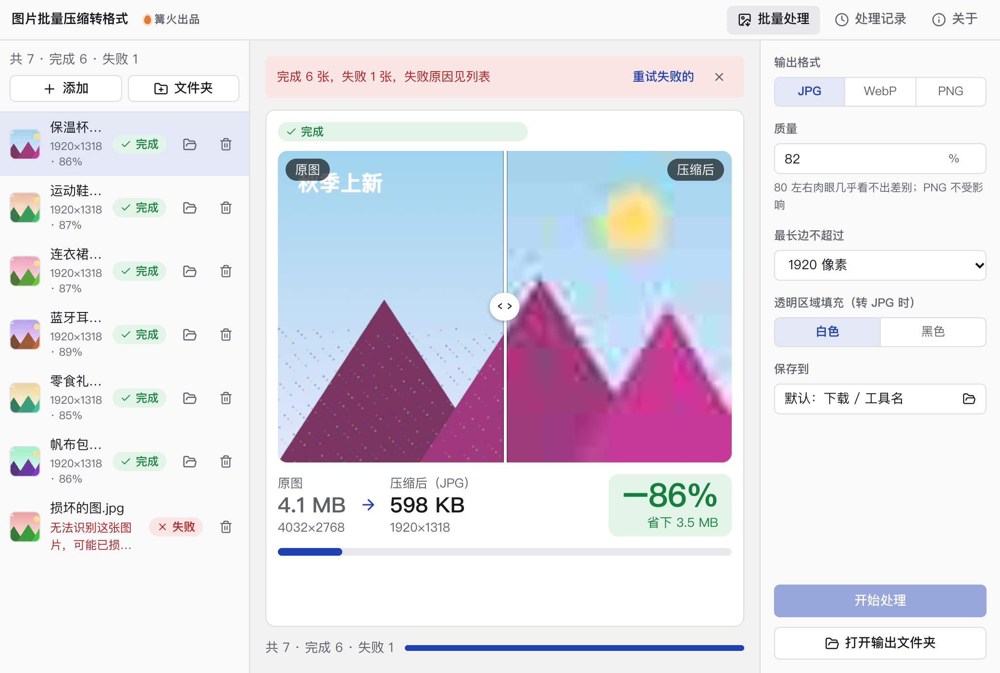

# 图片批量压缩转格式

> 篝火出品 · 收录于篝火 App 应用区

压缩、转 WebP / JPG，保持清晰



## 下载

到 [Releases](https://github.com/campfire-code/image-compressor/releases/latest) 下载对应安装包：

| 电脑 | 文件 |
|---|---|
| Windows 10 / 11 | `image-compressor_版本号_windows-x64-setup.exe` |
| Mac（Apple 芯片） | `image-compressor_版本号_mac-arm64.dmg` |
| Mac（Intel 芯片） | `image-compressor_版本号_mac-x64.dmg` |

第一次打开：
- **Windows**：如果弹出「Windows 已保护你的电脑」，点「更多信息」→「仍要运行」。
- **Mac**：如果提示「无法验证开发者」，打开「系统设置 → 隐私与安全性」，在下方点「仍要打开」。

## 怎么用

1. 把图片或整个文件夹拖进窗口，也可以点「添加图片」「添加文件夹」。支持 JPG、PNG、WebP、BMP、GIF。
2. 在右侧选输出格式、质量、最长边限制。转成 JPG 时，透明区域按选择填成白色或黑色。
3. 点「开始处理」。列表里每张图会显示新尺寸和压缩前后的大小。
4. 处理完点「打开输出文件夹」。默认保存在「下载 / 图片批量压缩转格式」，原图不会被改动。

全部在本机完成，不联网、不上传。

## 验收用例

把 `samples/` 文件夹整个拖进窗口，保持默认参数（JPG、质量 82%、最长边 1920 像素），点「开始处理」：

| 示例文件 | 原尺寸 | 应得到 |
|---|---|---|
| `big-4000x3000.png` | 4000×3000 | `big-4000x3000.jpg`，1920×1440，体积明显变小 |
| `transparent-800.png` | 800×800，带透明 | `transparent-800.jpg`，800×800，透明处变白色 |
| `broken.jpg` | 损坏文件 | 列表显示「失败：无法识别这张图片，可能已损坏或格式不受支持」 |

## 自己编译

需要 Node.js 22、pnpm、Rust。

```bash
pnpm install
pnpm test          # 单元测试
pnpm tauri dev     # 开发运行
pnpm tauri build   # 打包
```

界面框架在 `src/kit`（所有 campfire-code 工具共用），本工具的逻辑在 `src/tool`。

## 致谢

本工具基于开源项目 [GoogleChromeLabs/squoosh](https://github.com/GoogleChromeLabs/squoosh)（Apache-2.0）。

## 归属

本工具由**篝火**出品，是篝火 App 应用区收录的开源工具之一，由篝火（GitHub 组织 [campfire-code](https://github.com/campfire-code)）维护与更新。全部工具的目录见 [toolkit-hub](https://github.com/campfire-code/toolkit-hub)。

## 许可证

MIT，版权方为篝火（campfire-code）。
